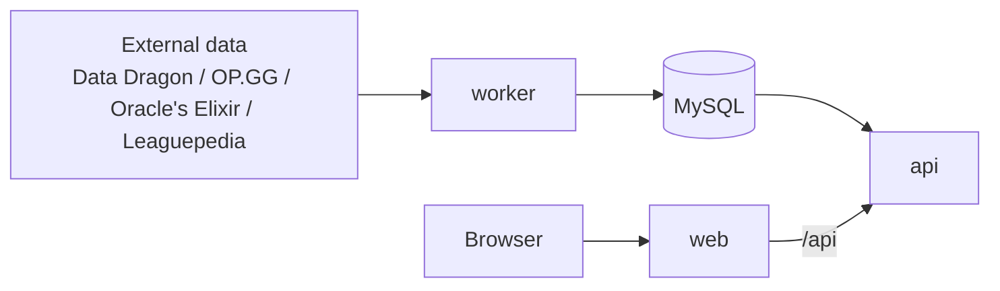

<div align="center">

# Draft.GG

A web tool that assists with League of Legends drafts (bans and picks).<br>
It combines statistics from stat sites with pro-match picks and bans, and suggests what to pick or ban next, with reasons.

[](LICENSE)


[Overview](#overview) · [Features](#features) · [How it works](#how-it-works) · [Setup](#setup) · [Configuration](#configuration) · [Development](#development) · [Contributing](#contributing) · [License](#license)

[日本語](README.md) · [English](README.en.md) · [한국어](README.ko.md)

</div>

---

## Overview

Draft.GG assists with Summoner's Rift (5v5) drafts. Enter the bans and picks of both teams by hand, and it suggests pick and ban candidates for the current situation.

- It is designed for solo / duo (ranked) and for five-player teams (clash, scrims, tournaments). In team use, one person operates the tool and shares the screen.
- Input is manual on the web only. There is no integration with the League client.
- It does not claim to predict the outcome. It presents numbers and reasons as material for your own decision.

## Features

### Draft board

- Enter bans and picks following the ranked or tournament format rules (with Blue / Red selection).
- Any slot can be edited afterwards to fix input mistakes.
- Champions can be searched by Japanese or English name.

### Suggestions

The tool sums the following factors with weights and returns pick and ban candidates with reasons.

| Factor      | Description                                                          |
| ----------- | -------------------------------------------------------------------- |
| Meta        | Win rate and tier in the current patch                               |
| Counter     | Win rate against the opposing lane's pick                            |
| Synergy     | Win rate in combination with allied picks                            |
| Pro         | Presence and win rate in major leagues and international events      |
| Pool        | Champions each player is comfortable with                            |
| Composition | Balance of allied damage types (AD / AP) and presence of a frontline |

Factors with few games are labeled "insufficient sample" in the reasons. Weights can be adjusted on the settings screen (`/settings`) and are saved in the browser.

### Other screens

| Path        | Description                                                                          |
| ----------- | ------------------------------------------------------------------------------------ |
| `/`         | Mode selection (solo / team) and data update status                                  |
| `/draft`    | Draft board and suggestions                                                          |
| `/pro`      | Pick rate, ban rate, and win rate in pro matches by league and period                |
| `/profiles` | Players and champion pools. Pools can be imported from OP.GG history using a Riot ID |
| `/teams`    | Register five players and assign roles                                               |
| `/settings` | Adjust suggestion weights                                                            |

Signing in with Discord is optional. When signed out, pools, teams, and drafts are saved in the browser.

## How it works

Statistics are imported into MySQL by scheduled batch jobs. Suggestions are computed only from the imported data, without querying external services at request time.



| Location                | Role                                                             |
| ----------------------- | ---------------------------------------------------------------- |
| `apps/web`              | Next.js (App Router) UI                                          |
| `apps/api`              | Hono REST API, authentication, suggestion computation            |
| `apps/worker`           | Scheduled batch jobs. Imports and aggregates external data       |
| `packages/engine`       | Suggestion scoring (pure functions, independent of DB and HTTP)  |
| `packages/db`           | MySQL connection, Drizzle schema, and migrations                 |
| `packages/data-sources` | Adapters for external data                                       |
| `packages/shared`       | Shared types, Zod schemas, and draft rule definitions            |
| `deploy/`               | systemd unit templates (unverified; adjust for your environment) |

### Tech stack

TypeScript / pnpm workspaces + Turborepo / Next.js / Tailwind CSS / TanStack Query / Hono / Drizzle ORM (MySQL) / Better Auth / Vitest / Oxlint and Oxfmt

## Setup

### Requirements

- Node.js 24 or later
- pnpm (the version in `packageManager` of `package.json`)
- MySQL (a database created with the `utf8mb4` character set)

### Steps

1. Install dependencies.

   ```bash
   pnpm install
   ```

2. Copy `.env.example` to `.env` and set `DATABASE_URL`. Write values only in `.env` and never commit it.

   ```bash
   cp .env.example .env
   ```

3. Apply the migrations to the database.

   ```bash
   pnpm --filter @draftgg/db db:migrate
   ```

4. Start web, api, and worker.

   ```bash
   pnpm dev
   ```

   The web app listens on `http://localhost:3000` and the api on `127.0.0.1:3001`. API calls from the browser go through the same-origin `/api`, which the web app proxies.

The worker imports the statistics. The champion list (Data Dragon) is imported at startup and daily at a scheduled time, while OP.GG and pro-match statistics are imported by daily scheduled jobs, so statistics may be empty at first.

## Configuration

Set environment variables in `.env` at the repository root. The key names are in `.env.example`.

| Variable                                                | Description                                                                                                                                 |
| ------------------------------------------------------- | ------------------------------------------------------------------------------------------------------------------------------------------- |
| `DATABASE_URL`                                          | MySQL connection string (`mysql://<user>:<password>@<host>:<port>/<database>`). Used by api, worker, and migrations                         |
| `API_HOST` / `API_PORT`                                 | api listen address. The api fails to start if `API_HOST` is anything other than `127.0.0.1` (or `::1`)                                      |
| `WEB_PORT`                                              | web listen port (referenced by `next start` in production)                                                                                  |
| `BETTER_AUTH_URL` / `BETTER_AUTH_SECRET`                | For Discord login. The public URL and a random string of at least 32 characters                                                             |
| `DISCORD_CLIENT_ID` / `DISCORD_CLIENT_SECRET`           | For Discord login. Issue them under OAuth2 in the Developer Portal and register `<BETTER_AUTH_URL>/api/auth/callback/discord` as a redirect |
| `ORACLES_ELIXIR_CSV_URL`                                | Optional. Set only to replace the Oracle's Elixir CSV with a direct link                                                                    |
| `LEAGUEPEDIA_BOT_USERNAME` / `LEAGUEPEDIA_BOT_PASSWORD` | Optional. Leaguepedia bot credentials. If unset, pick-order completion is skipped                                                           |

> [!NOTE]
> If all four Discord login variables are empty, the app runs without login. Setting only some of them causes an error at startup.

## Development

CI is not used, so please check locally before submitting changes.

| Purpose             | Command                                 |
| ------------------- | --------------------------------------- |
| Type check          | `pnpm typecheck`                        |
| Tests               | `pnpm test`                             |
| Lint                | `pnpm lint`                             |
| Format / check only | `pnpm format` / `pnpm format:check`     |
| Build               | `pnpm build`                            |
| Generate migrations | `pnpm --filter @draftgg/db db:generate` |

## Contributing

Issues and pull requests are welcome. See [CONTRIBUTING.md](CONTRIBUTING.md) for details (written in Japanese).

## License

Provided under the [Apache License 2.0](LICENSE). Copyright 2026 Harukoto Project

## Data sources and legal notice

- Data sources: Data Dragon, OP.GG, Oracle's Elixir, Leaguepedia
- Please check the terms of use for data from external services such as OP.GG yourself.
- This service is not endorsed by Riot Games and does not reflect the views or opinions of Riot Games. League of Legends and Riot Games are trademarks or registered trademarks of Riot Games, Inc. League of Legends © Riot Games, Inc.
