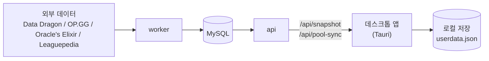

<div align="center">

# Draft.GG

리그 오브 레전드의 드래프트(밴 / 픽)를 돕는 데스크톱 앱(Windows / macOS)입니다.<br>
통계 사이트의 수치와 프로 경기의 픽·밴을 조합하여, "다음에 무엇을 픽 / 밴해야 하는지"를 이유와 함께 제안합니다.

[](LICENSE)


[개요](#개요) · [주요 기능](#주요-기능) · [설치](#설치) · [동작 방식](#동작-방식) · [개발 환경 설정](#개발-환경-설정) · [설정](#설정) · [개발](#개발) · [기여](#기여) · [라이선스](#라이선스)

[日本語](README.md) · [English](README.en.md) · [한국어](README.ko.md)

</div>

---

## 개요

Draft.GG는 소환사의 협곡(5v5) 드래프트를 돕는 도구입니다. 아군과 상대 팀의 밴·픽을 직접 입력하면, 현재 상황에 맞춰 픽과 밴 후보를 제안합니다.

- 솔로 / 듀오(랭크 게임)와 5인 팀(클래시, 스크림, 대회)을 모두 상정합니다. 팀 사용 시에는 한 명이 조작하고 화면을 공유하는 방식입니다.
- 입력은 수동 입력만 지원합니다. LoL 클라이언트와는 연동하지 않습니다.
- 승패를 단정하는 도구가 아닙니다. 판단 자료로서 수치와 이유를 제시합니다.

## 주요 기능

### 드래프트 보드

- 랭크 게임 형식과 대회 형식(Blue / Red 선택 포함)의 진행 규칙에 따라 밴·픽을 입력합니다.
- 입력 실수를 고칠 수 있도록, 임의의 칸을 나중에 편집할 수 있습니다.
- 챔피언은 일본어 이름과 영어 이름으로 검색할 수 있습니다.

### 제안

다음 요소를 가중치와 함께 합산하여, 픽과 밴 후보를 이유와 함께 제시합니다.

| 요소   | 내용                                             |
| ------ | ------------------------------------------------ |
| 메타   | 현재 패치의 승률과 티어                          |
| 카운터 | 상대 맞라인 픽에 대한 승률                       |
| 시너지 | 아군 픽과의 조합 승률                            |
| 프로   | 주요 리그와 국제 대회에서의 출현율과 승률        |
| 풀     | 플레이어가 잘 다루는 챔피언                      |
| 구성   | 아군의 피해 유형(AD / AP) 편중과 프런트라인 유무 |

경기 수가 적은 요소는 이유에 "샘플 부족"으로 표시합니다. 가중치는 설정 화면(`/settings`)에서 조정할 수 있으며 앱에 저장됩니다.

### 기타 화면

| 경로        | 내용                                                                   |
| ----------- | ---------------------------------------------------------------------- |
| `/`         | 모드 선택(솔로 / 팀)과 데이터 업데이트 현황                            |
| `/draft`    | 드래프트 보드와 제안                                                   |
| `/pro`      | 리그·기간별 프로 경기의 채용률·밴률·승률                               |
| `/profiles` | 플레이어와 챔피언 풀. Riot ID로 OP.GG의 사용 기록을 가져올 수 있습니다 |
| `/teams`    | 5명의 등록과 역할 배정                                                 |
| `/settings` | 제안 가중치 조정                                                       |

로그인은 필요하지 않습니다. 플레이어·팀·저장한 드래프트는 사용 중인 PC의 앱 데이터 폴더에만 저장되며, 서버로 전송되지 않습니다.

## 설치

[Releases](https://github.com/Harukoto-Project/draft.gg/releases)에서 사용 중인 OS(Windows / macOS)용 설치 파일을 내려받아 실행합니다.

> [!NOTE]
> 설치 파일에는 서명이 되어 있지 않습니다. 처음 실행할 때 Windows SmartScreen이나 macOS Gatekeeper가 경고를 표시합니다.

통계 데이터는 실행할 때 자동으로 가져와 앱에 저장합니다. 가져오지 못했을 때도 이전에 저장한 데이터로 제안할 수 있습니다.

## 동작 방식

통계는 정기 배치로 MySQL에 가져오며, api가 하나의 스냅샷으로 묶어 제공합니다. 앱은 그것을 가져와 저장하고, 제안 계산은 앱 안(Rust)에서 수행합니다. 제안할 때 외부 서비스에 문의하지 않습니다.

플레이어·팀·저장한 드래프트는 앱 데이터 폴더(`userdata.json`)에만 저장하며, 서버로 전송하지 않습니다. 서버를 사용하는 것은 통계를 가져올 때와 OP.GG에서 풀을 가져올 때(로그인 불필요, IP별 횟수 제한)뿐입니다.



| 위치                                     | 역할                                                                       |
| ---------------------------------------- | -------------------------------------------------------------------------- |
| `apps/desktop`                           | Tauri 2 데스크톱 앱. 화면은 Vite + React, Rust 쪽은 `src-tauri/`           |
| `apps/desktop/src-tauri/crates/engine`   | 제안 점수 계산(I/O와 Tauri에 의존하지 않음)                                |
| `apps/desktop/src-tauri/crates/snapshot` | 스냅샷 가져오기(ETag)와 캐시                                               |
| `apps/desktop/src-tauri/crates/storage`  | 플레이어·팀·저장한 드래프트의 로컬 저장                                    |
| `apps/api`                               | Hono 읽기 전용 API(snapshot / meta / pro / champions / status)와 pool-sync |
| `apps/worker`                            | 정기 배치. 외부 데이터 가져오기와 집계                                     |
| `packages/db`                            | MySQL 연결, Drizzle 스키마와 마이그레이션                                  |
| `packages/data-sources`                  | 외부 데이터 어댑터                                                         |
| `packages/shared`                        | 타입, Zod 스키마, 드래프트 진행 규칙 등의 공통 정의                        |
| `deploy/`                                | api·worker의 systemd 유닛 템플릿(미검증. 환경에 맞게 조정하세요)           |

### 기술 스택

Tauri 2 / Rust / TypeScript / React / Vite / Tailwind CSS / TanStack Query / Hono / Drizzle ORM(MySQL) / pnpm workspaces + Turborepo / Vitest / Oxlint·Oxfmt

## 개발 환경 설정

앱을 개발할 때의 절차입니다. 사용만 하려면 [설치](#설치)를 참고하세요.

### 요구 사항

- Node.js 24 이상
- pnpm(`package.json`의 `packageManager`에 적힌 버전)
- Rust(stable)와 OS별 Tauri 사전 요구 도구([Tauri 사전 요구 사항](https://v2.tauri.app/start/prerequisites/))
- MySQL(문자 인코딩이 `utf8mb4`인 데이터베이스). api / worker를 실행할 때 필요합니다

### 절차

1. 의존성을 설치합니다.

   ```bash
   pnpm install
   ```

2. `.env.example`을 `.env`로 복사하고 `DATABASE_URL`을 설정합니다. 값은 `.env`에만 적고 커밋하지 마세요.

   ```bash
   cp .env.example .env
   ```

3. 데이터베이스에 마이그레이션을 적용합니다.

   ```bash
   pnpm --filter @draftgg/db db:migrate
   ```

4. api / worker를 실행합니다. api는 `127.0.0.1:3001`에서 대기합니다.

   ```bash
   pnpm --filter @draftgg/api --filter @draftgg/worker dev
   ```

5. 다른 터미널에서 앱을 실행합니다. 연결 대상 api는 기본적으로 `http://127.0.0.1:3001`입니다.

   ```bash
   pnpm --filter @draftgg/desktop tauri:dev
   ```

통계는 worker가 가져옵니다. 챔피언 목록(Data Dragon)은 시작 시와 매일 정해진 시각에, OP.GG와 프로 경기 통계는 매일 정해진 시각의 작업으로 가져오므로 처음에는 통계가 비어 있을 수 있습니다.

## 설정

환경 변수는 저장소 루트의 `.env`에서 설정합니다. 키 이름은 `.env.example`에 있습니다.

| 변수                                                    | 내용                                                                                                                     |
| ------------------------------------------------------- | ------------------------------------------------------------------------------------------------------------------------ |
| `DATABASE_URL`                                          | MySQL 접속 문자열(`mysql://<사용자>:<비밀번호>@<호스트>:<포트>/<데이터베이스 이름>`). api / worker / 마이그레이션이 사용 |
| `API_HOST` / `API_PORT`                                 | api 대기 주소. `API_HOST`가 `127.0.0.1`(또는 `::1`)이 아니면 시작 시 오류가 발생합니다                                   |
| `ORACLES_ELIXIR_CSV_URL`                                | 선택. Oracle's Elixir CSV를 직접 링크로 바꿀 때만 설정                                                                   |
| `LEAGUEPEDIA_BOT_USERNAME` / `LEAGUEPEDIA_BOT_PASSWORD` | 선택. Leaguepedia 봇 인증 정보. 설정하지 않으면 픽 순서 보완을 건너뜁니다                                                |

개발 중에 앱이 연결하는 api의 URL은 환경 변수 `DRAFTGG_API_URL`로 바꿀 수 있습니다(기본값 `http://127.0.0.1:3001`). 릴리스 빌드에서는 GitHub 저장소 변수 `DRAFTGG_API_URL`의 값을 사용합니다.

## 개발

CI는 사용하지 않으므로, 변경을 제출하기 전에 로컬에서 확인해 주세요.

| 목적               | 명령                                    |
| ------------------ | --------------------------------------- |
| 타입 검사          | `pnpm typecheck`                        |
| 테스트             | `pnpm test`                             |
| Lint               | `pnpm lint`                             |
| 포맷 / 포맷 확인만 | `pnpm format` / `pnpm format:check`     |
| 빌드               | `pnpm build`                            |
| 마이그레이션 생성  | `pnpm --filter @draftgg/db db:generate` |

### 릴리스

1. `apps/desktop/src-tauri/tauri.conf.json`과 `Cargo.toml`의 `version`을 올립니다.
2. 저장소 변수 `DRAFTGG_API_URL`에 api의 공개 URL(https)을 등록합니다(처음 한 번만).
3. `v<버전>` 태그를 만들어 푸시합니다. GitHub Actions가 Windows와 macOS 설치 파일을 만들어 Releases에 초안으로 올립니다. 내용을 확인한 뒤 공개하세요.

## 기여

Issue와 Pull Request를 환영합니다. 자세한 내용은 [CONTRIBUTING.md](CONTRIBUTING.md)를 참고하세요(일본어로 작성되어 있습니다).

## 라이선스

[Apache License 2.0](LICENSE)으로 제공합니다. Copyright 2026 Harukoto Project

## 데이터 출처와 권리 표기

- 데이터 출처: Data Dragon, OP.GG, Oracle's Elixir, Leaguepedia
- OP.GG 등 외부 서비스 데이터의 이용 조건은 이용자가 직접 확인해 주세요.
- 이 서비스는 Riot Games의 승인을 받은 것이 아니며, Riot Games의 견해나 의견을 반영하지 않습니다. League of Legends와 Riot Games는 Riot Games, Inc.의 상표 또는 등록 상표입니다. League of Legends © Riot Games, Inc.
