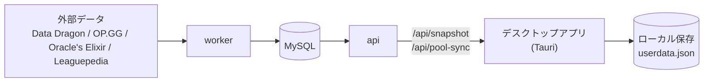

<div align="center">

# Draft.GG

League of Legendsのドラフト(BAN / ピック)を補助するデスクトップアプリ(Windows / macOS)。<br>
統計サイトの数値とプロ試合のピック・BANを組み合わせ、「次に何をピック / BANすべきか」を理由付きで提案します。

[](LICENSE)


[概要](#概要) · [主な機能](#主な機能) · [インストール](#インストール) · [仕組み](#仕組み) · [セットアップ](#セットアップ) · [設定](#設定) · [開発](#開発) · [貢献](#貢献) · [ライセンス](#ライセンス)

[日本語](README.md) · [English](README.en.md) · [한국어](README.ko.md)

</div>

---

## 概要

Draft.GGは、サモナーズリフト(5v5)のドラフトを補助するツールです。自チームと相手チームのBAN・ピックを手動で入力すると、現在の状況に合わせてピックとBANの候補を提案します。

- ソロ / デュオ(ランク戦)と、5人チーム(クラッシュ・スクリム・大会)の両方を想定しています。チームでは1人が操作し、画面を共有する使い方です。
- 入力は手動のみです。LoLクライアントとの連携は行いません。
- 勝敗を断定するものではありません。判断材料として、数値と理由を示します。

## 主な機能

### ドラフトボード

- ランク戦形式と大会形式(Blue / Red選択あり)の進行ルールに沿って、BAN・ピックを入力します。
- 入力ミスの修正のため、任意の枠をあとから編集できます。
- チャンピオンは日本語名・英語名で検索できます。

### 提案

次の要素を重み付きで合計し、ピックとBANの候補を理由付きで出します。

| 要素       | 内容                                                    |
| ---------- | ------------------------------------------------------- |
| メタ       | 現パッチでの勝率とティア                                |
| カウンター | 相手の対面ロールに対する勝率                            |
| シナジー   | 味方ピックとの組み合わせ勝率                            |
| プロ       | 主要リーグ・国際大会でのプレゼンスと勝率                |
| プール     | プレイヤーの得意なチャンピオン                          |
| 構成       | 味方のダメージ種別(AD / AP)の偏りとフロントラインの有無 |

試合数が少ない要素は、理由に「サンプル不足」と表示します。重みは設定画面(`/settings`)で調整でき、アプリに保存されます。

### その他の画面

| パス        | 内容                                                                     |
| ----------- | ------------------------------------------------------------------------ |
| `/`         | モード選択(ソロ / チーム)とデータの更新状況                              |
| `/draft`    | ドラフトボードと提案                                                     |
| `/pro`      | リーグ・期間別のプロ試合の採用率・BAN率・勝率                            |
| `/profiles` | プレイヤーとチャンピオンプール。Riot IDからOP.GGの使用履歴を取り込めます |
| `/teams`    | 5人の登録とロール割り当て                                                |
| `/settings` | 提案の重みの調整                                                         |

ログインは不要です。プレイヤー・チーム・保存したドラフトは、お使いのPCのアプリのデータフォルダにだけ保存し、サーバーには送りません。

## インストール

[Releases](https://github.com/Harukoto-Project/draft.gg/releases)から、お使いのOS(Windows / macOS)のインストーラーをダウンロードして実行します。

> [!NOTE]
> インストーラーには署名していません。初回は、WindowsのSmartScreenやmacOSのGatekeeperが警告を出します。

統計データは、起動時に自動で取得してアプリに保存します。取得できなかったときも、前回保存したデータで提案できます。

## 仕組み

統計は定期バッチでMySQLに取り込み、apiが1つのスナップショットにまとめて配信します。アプリはそれを取得して保存し、提案の計算はアプリの中(Rust)で行います。提案のときに外部へ問い合わせることはありません。

プレイヤー・チーム・保存したドラフトはアプリのデータフォルダ(`userdata.json`)にだけ保存し、サーバーには送りません。サーバーを使うのは、統計の取得と、OP.GGからのプールの取り込み(ログイン不要。IPごとに回数を制限)だけです。



| 場所                                     | 役割                                                                         |
| ---------------------------------------- | ---------------------------------------------------------------------------- |
| `apps/desktop`                           | Tauri 2のデスクトップアプリ。画面はVite + React、Rust側は`src-tauri/`        |
| `apps/desktop/src-tauri/crates/engine`   | 提案のスコア計算(I/OにもTauriにも依存しない)                                 |
| `apps/desktop/src-tauri/crates/snapshot` | スナップショットの取得(ETag)とキャッシュ                                     |
| `apps/desktop/src-tauri/crates/storage`  | プレイヤー・チーム・保存ドラフトのローカル保存                               |
| `apps/api`                               | Honoの読み取り専用API(snapshot / meta / pro / champions / status)とpool-sync |
| `apps/worker`                            | 定期バッチ。外部データの取り込みと集計                                       |
| `packages/db`                            | MySQLの接続、Drizzleのスキーマとマイグレーション                             |
| `packages/data-sources`                  | 外部データのアダプタ                                                         |
| `packages/shared`                        | 型、Zodスキーマ、ドラフトの進行ルールなどの共通定義                          |
| `deploy/`                                | api・workerのsystemdユニットのひな形(未検証。環境に合わせて調整してください) |

### 技術スタック

Tauri 2 / Rust / TypeScript / React / Vite / Tailwind CSS / TanStack Query / Hono / Drizzle ORM(MySQL)/ pnpm workspaces + Turborepo / Vitest / Oxlint・Oxfmt

## セットアップ

アプリを開発するときの手順です。使うだけなら[インストール](#インストール)を参照してください。

### 動作要件

- Node.js 24以上
- pnpm(`package.json`の`packageManager`に記載のバージョン)
- Rust(stable)と、OSごとのTauriの前提ツール([Tauriの前提条件](https://v2.tauri.app/start/prerequisites/))
- MySQL(文字コードは`utf8mb4`で作成したデータベース)。api / workerを動かすときに必要です

### 手順

1. 依存関係をインストールします。

   ```bash
   pnpm install
   ```

2. `.env.example`を`.env`にコピーし、`DATABASE_URL`を設定します。値は`.env`にだけ書き、コミットしないでください。

   ```bash
   cp .env.example .env
   ```

3. データベースにマイグレーションを適用します。

   ```bash
   pnpm --filter @draftgg/db db:migrate
   ```

4. api / workerを起動します。apiは`127.0.0.1:3001`で待ち受けます。

   ```bash
   pnpm --filter @draftgg/api --filter @draftgg/worker dev
   ```

5. 別のターミナルでアプリを起動します。接続先のapiは、既定で`http://127.0.0.1:3001`です。

   ```bash
   pnpm --filter @draftgg/desktop tauri:dev
   ```

統計はworkerが取り込みます。チャンピオン一覧(Data Dragon)は起動時と毎日の定時に、OP.GGとプロ試合の統計は毎日の定時ジョブで取り込むため、初回は統計が空のことがあります。

## 設定

環境変数は、ルートの`.env`で設定します。キー名は`.env.example`にあります。

| 変数                                                    | 内容                                                                                                                           |
| ------------------------------------------------------- | ------------------------------------------------------------------------------------------------------------------------------ |
| `DATABASE_URL`                                          | MySQLの接続文字列(`mysql://<ユーザー>:<パスワード>@<ホスト>:<ポート>/<データベース名>`)。api / worker / マイグレーションが使う |
| `API_HOST` / `API_PORT`                                 | apiの待ち受け。`API_HOST`は`127.0.0.1`(または`::1`)以外だと起動時にエラーになります                                            |
| `ORACLES_ELIXIR_CSV_URL`                                | 任意。Oracle's ElixirのCSVの直リンクに差し替えるときだけ設定                                                                   |
| `LEAGUEPEDIA_BOT_USERNAME` / `LEAGUEPEDIA_BOT_PASSWORD` | 任意。Leaguepediaのbot認証情報。未設定ならピック順の補完をスキップします                                                       |

アプリがつなぐapiのURLは、開発中は環境変数`DRAFTGG_API_URL`で変えられます(既定は`http://127.0.0.1:3001`)。リリースビルドでは、GitHubのリポジトリ変数`DRAFTGG_API_URL`の値が使われます。

## 開発

CIは使っていないため、変更を出す前にローカルで確認してください。

| 目的                   | コマンド                                |
| ---------------------- | --------------------------------------- |
| 型チェック             | `pnpm typecheck`                        |
| テスト                 | `pnpm test`                             |
| Lint                   | `pnpm lint`                             |
| 整形 / 整形の確認のみ  | `pnpm format` / `pnpm format:check`     |
| ビルド                 | `pnpm build`                            |
| マイグレーションの生成 | `pnpm --filter @draftgg/db db:generate` |

### リリース

1. `apps/desktop/src-tauri/tauri.conf.json`と`Cargo.toml`の`version`を上げます。
2. リポジトリ変数`DRAFTGG_API_URL`に、apiの公開URL(https)を登録します(初回のみ)。
3. `v<バージョン>`のタグを作って送ります。GitHub Actionsが、WindowsとmacOSのインストーラーを作り、Releasesに下書きとして置きます。内容を確認して公開してください。

## 貢献

IssueとPull Requestを歓迎します。詳しくは[CONTRIBUTING.md](CONTRIBUTING.md)を参照してください。

## ライセンス

[Apache License 2.0](LICENSE)で提供します。Copyright 2026 Harukoto Project

## データ出典と権利表記

- データ出典: Data Dragon、OP.GG、Oracle's Elixir、Leaguepedia
- OP.GGなど外部サービスのデータの利用条件は、利用者自身で確認してください。
- このサービスはRiot Gamesの承認を受けたものではなく、Riot Gamesの見解や意見を反映するものでもありません。League of LegendsおよびRiot Gamesは、Riot Games, Inc.の商標または登録商標です。League of Legends © Riot Games, Inc.
